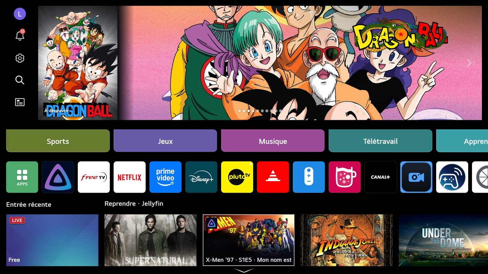
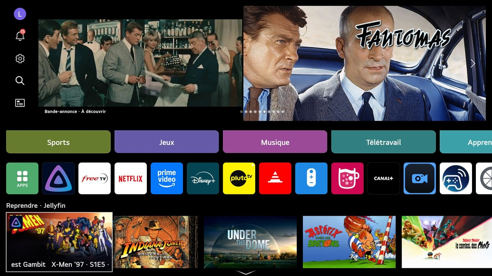
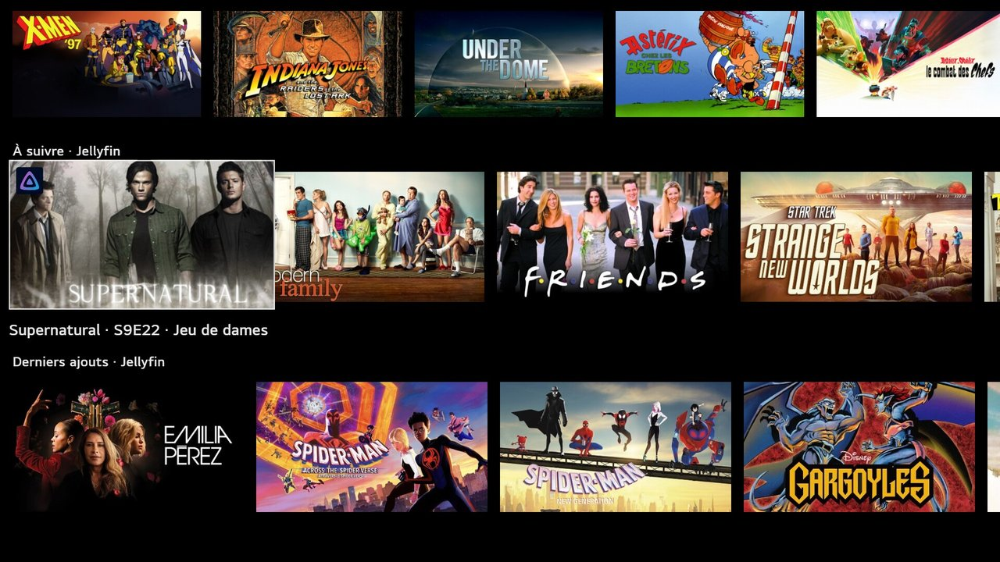

# JellyHome

**English** · [Français](README.fr.md)

Your Jellyfin server on the home screen of LG webOS TVs: the big top carousel, the
banner and rows show your movies and series with their artwork, and selecting one opens
it in the Jellyfin app.

**Rooted TV required** (Homebrew Channel). Tested on webOS 10.3.



| Trailer playing in the carousel | Jellyfin rows |
|---|---|
|  |  |

## Features

- **Top carousel**, in place of LG ads:
  - shows what you pick under "Top area" (continue watching, next up, recently added,
    favorites, discover…);
  - each item gets artwork composed on the TV: the poster on the left, the backdrop on
    the right, and the title logo in the top right corner (or the title in large type);
  - **trailers**: the item's Jellyfin trailer, or else the YouTube links from its
    metadata. They are downloaded in advance (480p, falling back to 720p, then 1080p)
    and played over the poster. The home screen turns the sound on when you are on it.
- **Banner** next to recent inputs and a **row** below it: a Jellyfin category, or
  LG's original content.
- **Rows**: continue watching, next up, recently added, with a progress bar.
- **LG ads hidden** (optional).
- **Selecting** an item opens the Jellyfin app on its details page.

Everything is set up in the JellyHome app. Signing in to the server uses Quick Connect:
no password to type.

## Installation

Install the IPK from a release with the Homebrew Channel. Open JellyHome once: the app
installs its boot hook and enables the home screen patch. Sign in with Quick Connect,
then press "Apply to home screen".

From source, on a rooted TV reachable over SSH (root, with a key):

```sh
sh tools/package.sh          # builds dist/<id>_<version>_all.ipk
sh tools/install.sh [IP]     # installs it on the TV (default 192.168.0.221)
```

`tools/build.sh` (run by `package.sh`) cross-compiles the shim for the TV in Docker
(armv7, glibc 2.35).

## How it works

The webOS home screen is a compiled Flutter app: it is not modified. JellyHome sits
between it and the luna bus.

- **`shim/homepatch.c`** → `libhomepatch.so`, loaded into the home screen with
  `LD_PRELOAD`. It intercepts luna calls and rewrites their replies according to
  `rules.json`: a reply can be replaced, merged or edited field by field, and the rules
  are reloaded on the fly. It can also copy an outgoing call to a file (clicks). Without
  a matching rule, everything goes through untouched.
- **`app/root/flutter-client`** is bind-mounted (in RAM) over `/usr/bin/flutter-client`.
  It adds the shim to the home screen only, with a guard: three crashes within a minute
  turn the patch off.
- **`app/root/jellyfeed.py`**, the service, runs on the TV:
  - it queries Jellyfin and writes the ready-made replies and `rules.json`;
  - it prepares the carousel artwork and trailers in the background;
  - it serves them over HTTP on `127.0.0.1:8097`, because the home screen does not read
    local files;
  - it opens the Jellyfin details page after a click.
- **`app/root/jellyhomectl.sh`** starts and stops everything: install, boot hook, home
  screen restart.
- **`app/`** is the settings app (HTML/JS). It runs its root commands through the
  Homebrew Channel.

The top carousel is the ad manager's `Portal/HomeBigCarousel@Main` slot. A video ad there
is a pair of assets, the video and a full-width image, and the video covers the left 46%.

The TV has neither Pillow nor ffmpeg, and its Python is stripped down, so everything is
done in pure Python:
- PNG decoding and encoding, and artwork composition;
- text drawn from pre-rendered glyphs: `tools/make-font.py`, Noto Sans Bold (OFL
  licence), produces `app/root/font-*`;
- YouTube trailers fetched by yt-dlp, downloaded on first use. yt-dlp passes YouTube's
  checks with the webOS Node.js. The missing Python modules are in `app/root/pylib`,
  with `xml` taken from CPython (PSF licence);
- DASH video and audio joined without re-encoding (`mux_fmp4`).

Data lives in `/media/developer/jellyhome`: `config.json` (Jellyfin session, readable by
root only), rules, replies, carousel cache (`ad/`). The interception is made of mounts
that are wiped on every reboot. Apart from the boot hook, nothing is written to the
system.

## Uninstall

In the app: "Disable patch". Over SSH:

```sh
/media/developer/apps/usr/palm/applications/com.smeagolworms4.jellyhome/root/jellyhomectl.sh uninstall
```

Then uninstall the app from the Homebrew Channel.

## Development

Claude (Anthropic) was used as an assistant for the implementation and documentation. The
maintainer is an experienced developer who led the development, reviewed the generated
code, and tested the app and its features on an LG TV (webOS 10.3) before release.

## Support

JellyHome is by [SmeagolWorms4](https://github.com/Smeagolworms4). Issues belong
[here](https://github.com/Smeagolworms4/lg-jellyfin-homeapp/issues), and you can talk
about the project on [SmeagolWorms4's Discord](https://discord.gg/xMBc5SQ). If you like
it, you can support it:

[](https://github.com/sponsors/Smeagolworms4)
[](https://www.buymeacoffee.com/smeagolworms4)
[](https://www.paypal.com/donate/?business=SURRPGEXF4YVU&no_recurring=0)

## Licence

MIT, see [LICENSE](LICENSE). Third-party components: cJSON (`shim/vendor`, MIT),
`app/root/pylib/xml` (CPython, PSF licence), pre-rendered Noto Sans Bold font
(`app/root/font-*`, OFL licence). yt-dlp (Unlicense) is downloaded by the TV, not
bundled.
